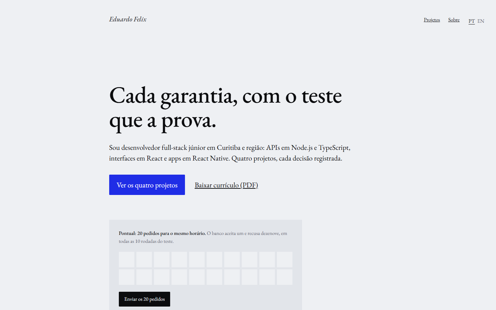
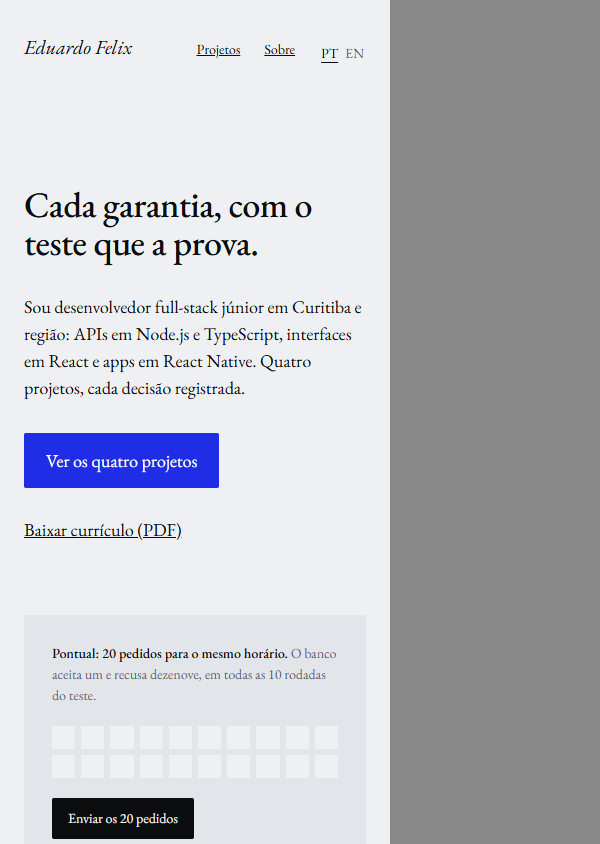
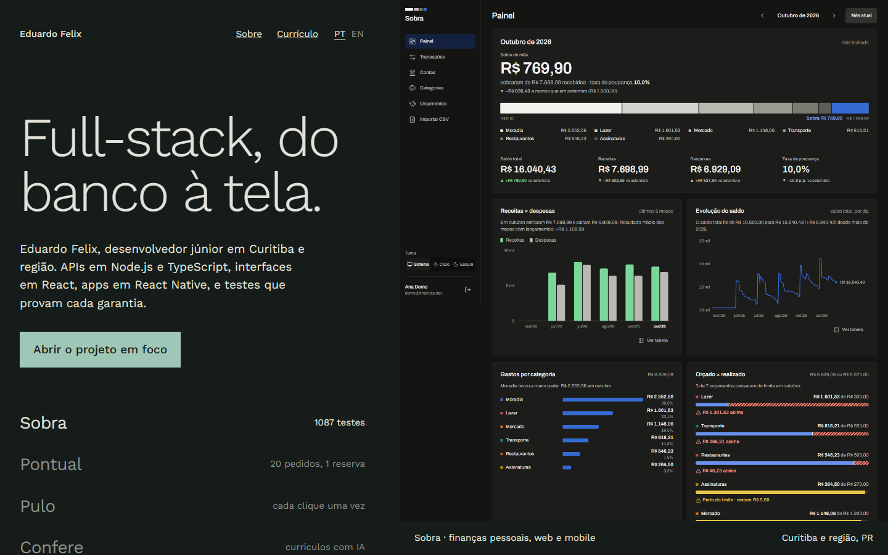
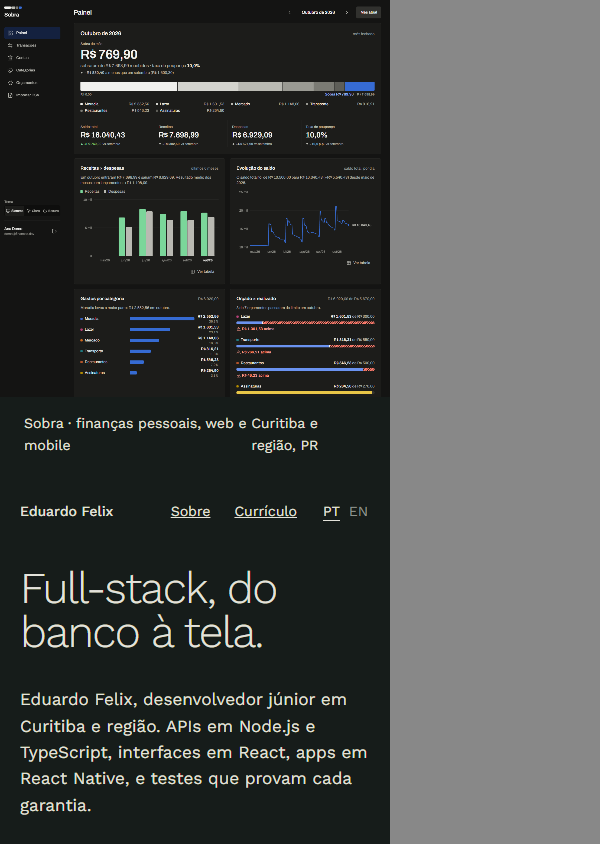

# Fase 1: duas direções de design

Data: 18/11/2026. Sorteio feito com `design-taste-frontend` (`draw.mjs --sector personal-portfolio`), que deu três
direções: *quiet-instrument*, *split-stage* e *dark-room*. Ficaram as duas que melhor carregam a ideia do conteúdo.
As folhas completas estão em `.taste-skill/quiet-instrument/` e `.taste-skill/split-stage/` (seed 1509731157 na A).

A ideia que vale para as duas vem de `content/conteudo.md`: **cada projeto tem uma garantia, e um teste que a prova**
(20 pedidos para 1 reserva, 1087 testes, cada clique contado uma vez). Nenhum outro portfólio júnior tem esses números.

Cada hero é um rascunho estático para escolher a direção, não a página final. Os dois já trazem o seletor PT/EN
funcionando, com os textos em inglês mais longos, para ver como o layout se comporta.

## A. Instrumento quieto

 

- **Ideia:** "a prova de cada garantia vira uma demonstração pequena e exata". A página quase sussurra, e as provas falam.
- **Tipografia:** EB Garamond, uma família só. Título em 500, texto em 400, sem caixa-alta e sem negrito pesado.
- **Paleta:** cinza frio `#eef0f3`, tinta quase preta `#0b0c0e`, cobalto `#1f2de6` só na ação e numa seção inteira em campo de cor.
- **Composição:** uma coluna estreita alinhada a 22% da largura, muito espaço vazio. Os projetos viram um "livro-razão" de linhas, com a captura aparecendo ao lado no hover.
- **A coisa viva:** "Enviar os 20 pedidos" (Pontual): 20 quadrados, 1 vira cobalto, 19 recusados. Cada projeto ganharia a sua demonstração (Sobra: arredondamento em centavos; Pulo: o mesmo clique contado uma vez).
- **Movimento:** troca lenta de imagem (crossfade de ~1,6 s), entradas discretas por seção.
- **Risco:** se ficar quieta demais, parece vazia. Precisa de capturas reais em cada seção.
- Arquivo: [`direcoes/a-instrumento.html`](direcoes/a-instrumento.html)

## B. Palco dividido

 

- **Ideia:** "a tela real de cada projeto fica parada de um lado enquanto o outro lado conta a decisão que a sustenta".
- **Tipografia:** Work Sans, uma família só. Título em 300 bem grande (até 96px), texto em 400.
- **Paleta:** verde-preto `#161c1a`, osso `#e3e2da`, jade pálido `#9fc7b8` só no botão.
- **Composição:** 45/55. À esquerda, o texto que rola. À direita, a captura fixa (sticky) em tela cheia, com uma faixa embaixo dizendo o projeto e a cidade.
- **A coisa viva:** o índice dos 4 projetos. Passar o mouse ou tocar troca a captura do palco (crossfade).
- **Movimento:** crossfade das capturas ao trocar de projeto e ao rolar para cada seção.
- **Risco:** monotonia (várias telas com o mesmo split). Pelo menos uma seção precisa quebrar a divisão e ocupar a largura toda. No celular a captura vem antes do nome, o que pode atrasar a resposta a "quem é".
- Arquivo: [`direcoes/b-palco.html`](direcoes/b-palco.html)

## Limites

- Só o hero de cada uma. As outras seções estão descritas, não feitas.
- As capturas são dos próprios projetos (`financas`, `agenda`, `encurtador`, `curriculo`), copiadas para `direcoes/img/`.
- Não rodei `inspect.mjs` nem `lint.mjs` nos rascunhos: o gate fica para a página final. Conferi a olho em 1440x900 e 390x844.
- A skill `impeccable` não foi carregada nesta fase (modo econômico); fica para a fase de construção, se fizer falta.
