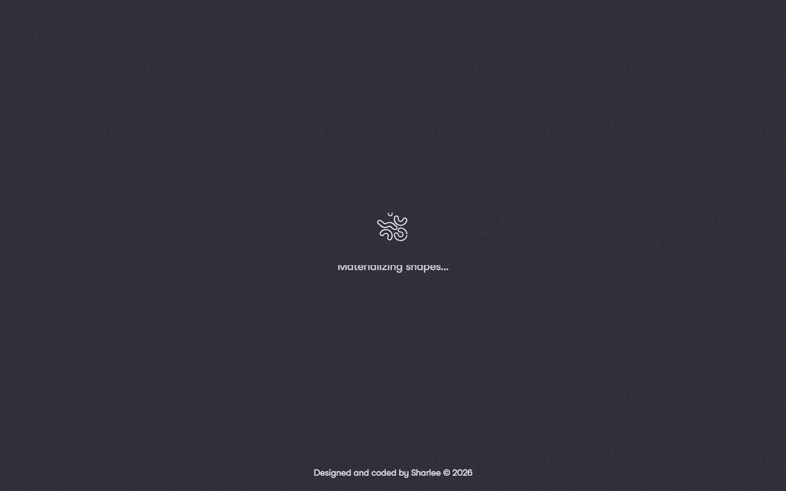
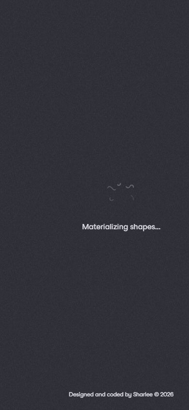
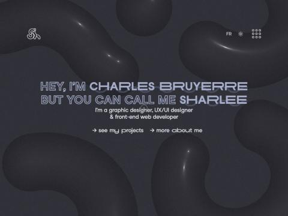
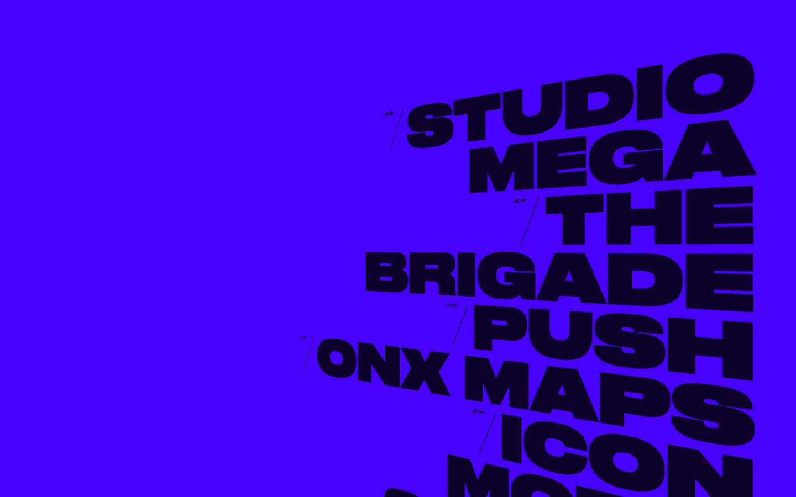
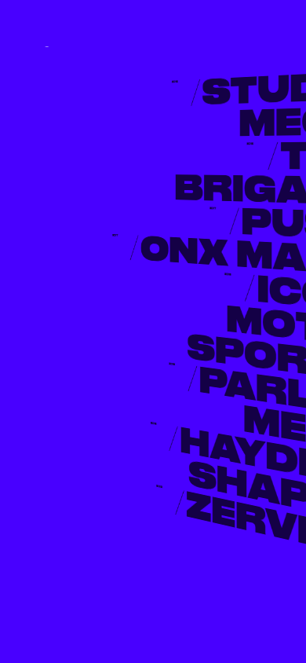
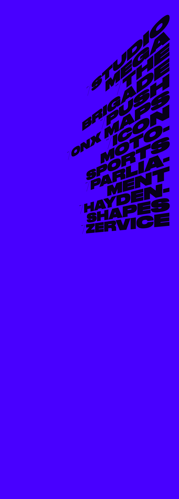
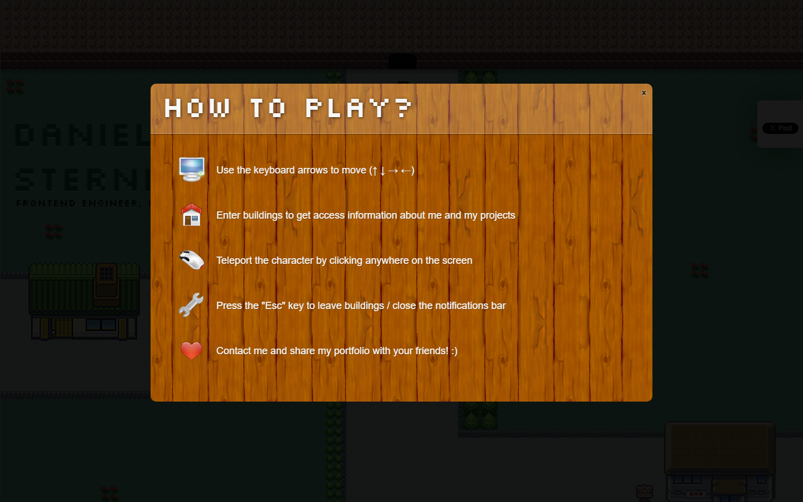
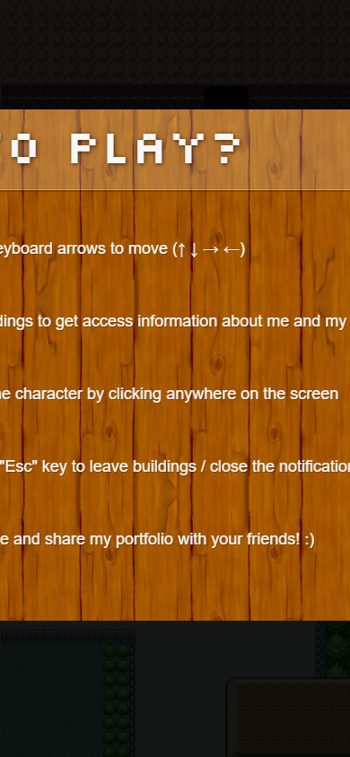
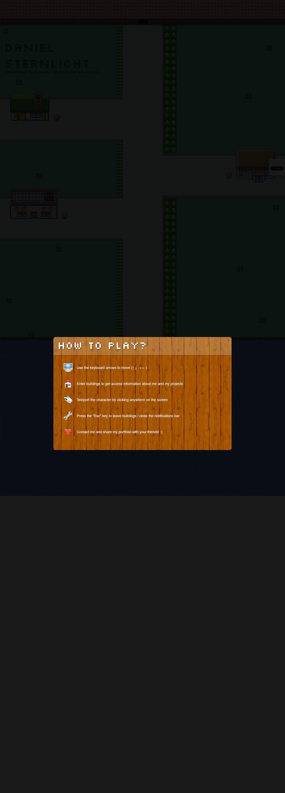

# Referências de portfólio: análise de princípios

Data da coleta: 18/11/2026. Objetivo: entender **o que** estes sites fazem bem (ritmo, tipografia, interação, transições) para inspirar um portfólio original, sem copiar layout, código, imagens ou textos.

## Como foi feito

- Capturas: Chrome instalado, modo headless (`--headless=new --disable-gpu --hide-scrollbars`), `--virtual-time-budget=10000`. Tamanhos: 1440x900 (desktop), 390x844 com user-agent de iPhone Safari (celular) e 1440x4000 (desktop longa).
- Sharlee só mostrava o preloader; refiz com `--virtual-time-budget=20000` (limite máximo combinado) e, num teste extra fora de `docs/`, com renderização WebGL por software (`--enable-unsafe-swiftshader`, sem `--disable-gpu`). Nas três tentativas ficou no preloader.
- HTML: em vez de WebFetch, usei o próprio Chrome headless com `--dump-dom` (DOM depois de rodar os scripts), salvo fora do projeto, e procurei com `grep` nomes de bibliotecas, fontes, atributos e propriedades CSS. Nenhum trecho de código foi copiado para cá.
- Legenda das afirmações sobre movimento e interação:
  - **[captura]**: visto num PNG.
  - **[HTML]**: deduzido do DOM/HTML (atributos, scripts, CSS inline).
  - **[suposição]**: hipótese razoável que eu não confirmei.

---

## 1. Sharlee: https://itssharl.ee/

### Capturas

| Desktop | Celular | Desktop longa |
|---|---|---|
|  |  |  |

Atenção: as três capturas headless mostram **só a tela de carregamento**, mesmo com 20 s de tempo virtual. A longa saiu como um fundo escuro com textura, sem conteúdo legível.

**Complemento (navegador com GPU, desktop 800x600):** 

- O hero só apareceu depois que o cursor entrou na página **[captura]**. Ou seja, a entrada da cena depende da interação.
- A cena tem formas 3D orgânicas, como tubos de grafite brilhante, ao redor do texto **[captura]**.
- O título está em caixa-alta, numa display larga, com nome e apelido destacados por um efeito de contorno e deslocamento de cor **[captura]**.
- Logo abaixo vêm a função em duas linhas e dois links com seta, "projetos" e "sobre" **[captura]**.
- No celular emulado (375x812), a página ficou em branco por 10 s sem interação **[captura]**, então o conteúdo não aparece sem um gesto.

### O que faz bem

- **Tipografia:** mesmo no preloader dá para ver uma sans geométrica arredondada, pequena, em cinza claro sobre grafite. Tem uma frase curta de status com tom bem-humorado no lugar de um "carregando" genérico **[captura]**. A fonte vem de arquivo próprio (`.woff2`) **[HTML]**.
- **Ritmo/layout:** o DOM tem `nav`, vários `h1` e um `main` com container. A navegação é por disciplina (desenvolvimento web, branding, game design, 3D, motion, retrato, ilustração) **[HTML]**. Ou seja, o portfólio é organizado por área de atuação e não por lista cronológica **[HTML]**. Como a página se distribui na tela não foi visto.
- **Movimento e interação:** existe um `<canvas>` renderizado por three.js r145 **[HTML]**, portanto há uma cena 3D/WebGL. O ícone do preloader é um traço orgânico que muda entre capturas (formas soltas no celular, mais formadas no desktop), o que indica que ele se desenha ou se anima enquanto carrega **[captura]**. O fundo tem um ruído/grão sutil **[captura]**. É provável que a cena 3D reaja ao mouse ou ao scroll **[suposição]**.
- **Transições:** a entrada é uma tela de carregamento com ícone animado e assinatura no rodapé **[captura]**. Como ela sai e entra no conteúdo não foi visto **[suposição: fade ou morph para a cena]**.
- **Celular:** o preloader se adapta bem (texto centralizado, rodapé alinhado à direita) **[captura]**. O viewport bloqueia o zoom (`user-scalable=no`) **[HTML]**, o que é ruim para acessibilidade.
- **Tecnologias detectadas:** Next.js (scripts em `/_next/static/...`) **[HTML]**, three.js r145 (atributo `data-engine` no canvas) **[HTML]**, React (implícito no Next.js) **[HTML]**. A palavra "motion" aparece só como nome de categoria, não como biblioteca **[HTML]**.

### O que observar sem copiar

- Um preloader com personalidade (traço desenhado + frase espirituosa) que já apresenta a identidade antes do conteúdo.
- Textura de grão sobre fundo escuro para deixar uma tela "chapada" mais viva.
- Navegação por áreas de atuação quando o trabalho é multidisciplinar.
- Cuidado: se o preloader demora (aqui passou de 20 s virtuais em headless), a primeira impressão vira espera. No meu portfólio o conteúdo principal deve aparecer sem depender de WebGL.

---

## 2. Vanholtz: https://vanholtz.co/

### Capturas

| Desktop | Celular | Desktop longa |
|---|---|---|
|  |  |  |

### O que faz bem

- **Tipografia:** a tipografia é o layout inteiro. A home é uma lista de nomes de projetos em caixa alta, numa sans extra-larga e pesadíssima (Druk Wide) **[captura + HTML]**, com Akzidenz-Grotesk para textos de apoio, servida pelo Typekit **[HTML]**. Os anos aparecem em corpo minúsculo ao lado de cada nome, separados por uma barra diagonal fina **[captura]**, e o contraste de escala (gigante × minúsculo) é o que cria hierarquia.
- **Ritmo/layout:** só duas cores (azul elétrico saturado + quase preto) e nenhuma imagem na home **[captura]**. O bloco fica alinhado à direita e deixa a metade esquerda vazia **[captura]**. Os nomes longos quebram com hífen para manter o bloco justificado **[captura]**.
- **Movimento e interação:** a lista aparece distorcida em perspectiva, e a distorção muda com o tamanho da janela: em 1440x900 as linhas se inclinam em leque, em 1440x4000 viram uma espiral/torção forte **[captura]**. O CSS tem `perspective` em unidades de viewport (vw), `perspective-origin` controlado por variável CSS e uma classe de "parallax perspective" **[HTML]**, então a deformação é 3D via CSS e muito provavelmente muda com o scroll e/ou o mouse **[suposição baseada no HTML]**. Há uma classe que distingue celular de desktop (`isMobile`) **[HTML]**, o que sugere um efeito mais leve no celular **[suposição]**.
- **Transições:** a navegação usa Barba.js; cada link de projeto tem uma transição nomeada própria (`data-barba="HomeTransition"`), e links externos ficam fora dela (`no-barba`) **[HTML]**. Então trocar de página não recarrega, e há uma animação de saída/entrada entre a lista e o projeto **[HTML]**. Como ela é visualmente não foi visto.
- **Celular:** a mesma lista com a mesma inclinação, mas os nomes passam da borda direita e ficam cortados **[captura]**. Pode ser intencional (o texto "sangra" para fora) ou efeito do headless; não dá para saber **[suposição]**. O viewport permite zoom até 5x **[HTML]**.
- **Tecnologias detectadas:** Barba.js 1.0.0 via cdnjs **[HTML]**, script próprio `/js/app.js` **[HTML]**, Typekit (Adobe Fonts) **[HTML]**, Google Analytics **[HTML]**. Não achei GSAP, three.js nem canvas **[HTML]**; o efeito 3D parece ser só CSS.

### O que observar sem copiar

- Tipografia como imagem: uma home sem fotos pode ser marcante se a tipografia tiver escala e peso extremos.
- Paleta de duas cores bem saturadas dá identidade instantânea.
- Profundidade com CSS `perspective` em vez de WebGL: barato, acessível ao leitor de tela (continua texto e links) e funciona sem canvas.
- Metadados mínimos (ano) colados ao item, em escala muito menor.
- Transições de página sem recarregar mantêm a sensação de "objeto contínuo".
- Ponto de atenção: conferir que nada essencial fica cortado no celular.

---

## 3. Daniel Sternlicht: https://danielsternlicht.com/

### Capturas

| Desktop | Celular | Desktop longa |
|---|---|---|
|  |  |  |

### O que faz bem

- **Tipografia:** fonte pixelada/bitmap nos títulos e no nome, combinando com a estética de jogo 16-bit **[captura]**; Google Fonts (Molengo, Lekton) e uma sans de sistema no texto corrido **[HTML]**. O modal de instruções usa ícones + uma frase curta por linha, fácil de ler **[captura]**.
- **Ritmo/layout:** o portfólio é um **mapa de jogo** visto de cima: estradas, cercas, gramados e casas, e cada casa é uma seção (sobre, serviços etc.) **[captura + HTML: ids como `aboutHouse`, `servicesHouse`, `mainRoad`]**. O ritmo vem do espaço navegável, não de um scroll vertical. A longa mostra o mapa acabando em ~2500 px e o resto vazio **[captura]**.
- **Movimento e interação:** o modal inicial explica os controles: setas movem um personagem, clicar teletransporta, entrar numa casa abre o conteúdo e Esc sai **[captura]**. Há um elemento de personagem (`id="daniel"`) e a biblioteca jQuery Spritely, usada para animar sprites **[HTML]**, então o personagem tem animação de caminhada por spritesheet **[suposição baseada no HTML]**. Não vi o personagem nas capturas, porque o modal escurece o fundo.
- **Transições:** a entrada é um onboarding em modal que escurece o mapa **[captura]**. A entrada numa casa deve trocar o cenário por um interior **[suposição a partir do modal e dos ids]**.
- **Celular:** não há meta viewport **[HTML]**, então o celular renderiza a largura de desktop e o modal sai cortado dos dois lados **[captura]**. Os controles dependem de teclado e clique **[captura]**, o que não se traduz bem em toque **[suposição]**.
- **Tecnologias detectadas:** jQuery 1.6.3 e jquery.spritely 0.6 **[HTML]**, scripts próprios `game.js` e `data.js` (conteúdo separado da lógica do jogo) **[HTML]**, widgets antigos de Facebook, Twitter, Google+ e Disqus **[HTML]**. É um site antigo; a ideia vale mais que a execução técnica.

### O que observar sem copiar

- Um conceito forte de navegação (explorar um lugar) torna o portfólio memorável e mostra habilidade técnica pela própria forma.
- Onboarding curto e com ícones quando a interação não é óbvia.
- Separar os dados do conteúdo da lógica de apresentação (`data.js` × `game.js`) facilita atualizar projetos.
- O que evitar: interação só por teclado, nenhum suporte a celular e nenhum caminho "atalho" para quem só quer ver os projetos rapidamente.

---

## Princípios em comum para o meu portfólio

1. **Uma ideia central, levada até o fim.** Cada site tem um conceito único (cena 3D com formas orgânicas, tipografia em perspectiva, mapa de jogo). Escolher um conceito meu e deixar que ele decida layout, movimento e navegação.
2. **Tipografia com contraste de escala extremo.** Títulos enormes e metadados minúsculos criam hierarquia sem precisar de muitos elementos (mais claro no Vanholtz).
3. **Paleta curta e decidida.** Duas ou três cores, com uma textura ou grão quando o fundo for liso.
4. **O movimento tem que servir à navegação.** Perspectiva que reage ao scroll, transição entre lista e projeto, personagem que leva às seções: a animação explica onde se está e para onde se vai.
5. **Transições de página contínuas.** Trocar de página sem "piscar" (no estilo Barba ou View Transitions) faz o site parecer um objeto só.
6. **Primeira tela rápida e com personalidade.** Se houver preloader, ele precisa ser curto e já apresentar a identidade; o conteúdo principal não pode depender de WebGL para aparecer.
7. **Celular e acessibilidade como requisito.** Meta viewport correto, sem bloquear zoom, nada essencial cortado, controles por toque e `prefers-reduced-motion` desligando o movimento pesado.
8. **Sempre um atalho para os projetos.** Por mais lúdica que seja a experiência, quem tem pressa precisa chegar ao trabalho em um clique.

## Limites desta análise

- **Capturas estáticas não mostram movimento:** curvas de easing, duração, resposta ao scroll e ao mouse, hover e as transições de página ficaram todas sem ver. O que está marcado como [HTML] ou [suposição] não foi observado em execução.
- **Sharlee foi capturado só parcialmente:** em headless (10 s, 20 s e WebGL por software) apareceu só o preloader. O hero foi visto uma vez no painel de navegador com GPU (sharlee-desktop-gpu.jpg). O scroll, as páginas internas e o celular com conteúdo não foram vistos.
- **O headless não é um navegador real:** sem GPU, sem interação, com tempo virtual. O corte do texto no celular do Vanholtz pode ser artefato disso.
- **O celular foi emulado** só pela largura da janela e pelo user-agent; sem toque real, densidade de pixels nem Safari de verdade.
- **Só a home foi analisada.** Páginas de projeto, "sobre" e contato não foram visitadas.
- **A detecção de tecnologias é por texto no DOM:** bibliotecas empacotadas e minificadas (por exemplo, GSAP dentro de `app.js` ou de um chunk do Next.js) podem existir sem aparecer no grep. Algumas ocorrências foram falsos positivos (por exemplo, "ogl" dentro de "google") e foram descartadas.
- **Desempenho, peso das páginas e acessibilidade** não foram medidos.
